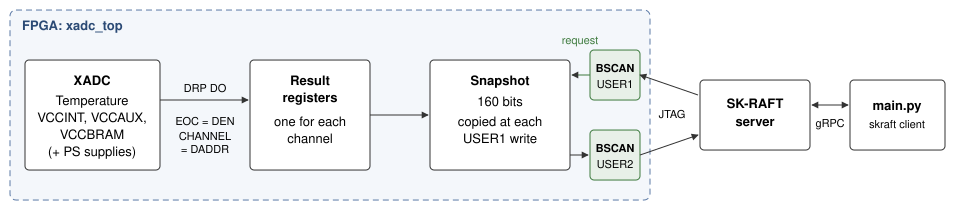

# XADC monitor: die temperature and supply voltages through JTAG

This standalone example reads the on-chip sensors of a 7-series FPGA or a Zynq-7000 device through the SK-RAFT server. The design uses the XADC of the device. The script reads the results through BSCAN.

The example supports the Basys 3 (`xc7a35tcpg236-1`) and the ZedBoard (`xc7z020clg484-1`). For other boards, refer to [Add a board](#add-a-board).

## What the example measures

| Value | Source | Basys 3 | ZedBoard |
| --- | --- | --- | --- |
| Die temperature | XADC temperature sensor, status register `00h` | Yes | Yes |
| VCCINT, VCCAUX, VCCBRAM | XADC supply sensors, `01h`, `02h`, `06h` | Yes | Yes |
| VCCPINT, VCCPAUX, VCCO_DDR (PS supplies) | XADC supply sensors, `0Dh` to `0Fh` | No | Yes |
| Over-temperature (OT) and alarms (ALM) | XADC outputs | Yes | Yes |
| On-chip power | Vivado `report_power` estimate | Estimate | Estimate |

The script uses the transfer functions of UG480:

- Temperature (°C) = code × 503.975 / 4096 − 273.15
- Supply voltage (V) = code × 3 / 4096

`code` is the 12-bit ADC result. It is in bits 15:4 of the 16-bit status register.

## Power consumption

The XADC measures temperature and voltage. It does not measure current. The Basys 3 and the ZedBoard do not have a current sensor that connects to the FPGA. Thus the script cannot measure power.

The script shows the on-chip power that Vivado calculates for the design (`report_power`, UG907). `build.tcl` writes this report after implementation. The report gives the total, dynamic and static power, and the current of each supply rail.

The estimate uses a junction temperature that Vivado calculates from the default environment (25 °C ambient). Static power increases with temperature. At the end of a run, the script shows the measured mean die temperature and these Vivado commands (UG907):

```tcl
set_operating_conditions -junction_temp <measured mean>
report_power
```

Enter the commands in Vivado with the implemented design open. Vivado then gives the estimate at the measured temperature.

### ZedBoard: input power of the board

The ZedBoard has a 10 mΩ current sense resistor in series with the 12 V input. Header J21 connects across this resistor (ZedBoard Hardware User's Guide). To measure the input power of the full board:

1. Measure the voltage across J21 with a multimeter.
2. Calculate the current: I = V(J21) / 0.010 Ω.
3. Calculate the power: P = 12 V × I. For a more accurate value, measure the adapter voltage and use it in place of 12 V.

Example: 4.0 mV across J21 gives 0.4 A and 4.8 W.

This value is the power of the full board (regulators, DDR3, PS, PL and peripherals), not only of the Zynq device.

Note: The ZedBoard Hardware User's Guide gives the formula "voltage squared divided by 10 mΩ". This formula gives only the power in the sense resistor. Use the formula above.

## How the example operates



1. The XADC operates in continuous sequence mode. The INIT values come from the instantiation example in UG480, with two changes: no auxiliary channels, and the PS supplies on Zynq-7000. Calibration is on. Each channel has an average of 16 samples.
2. At each end of conversion (EOC), the design reads the status register of that channel through the DRP. EOC connects to DEN and CHANNEL connects to DADDR (UG480). A pending flag blocks DEN until DRDY comes back. Thus a delayed DRP access cannot start a second read.
3. The script writes BSCAN USER1. The design then copies all results into a 160-bit snapshot.
4. The script reads BSCAN USER2. The snapshot does not change during the read. Thus all values come from the same snapshot.

The snapshot layout (bit 0 shifts out first):

| Bits | Contents |
| --- | --- |
| 15:0 | Temperature (`00h`) |
| 31:16 | VCCINT (`01h`) |
| 47:32 | VCCAUX (`02h`) |
| 63:48 | VCCBRAM (`06h`) |
| 79:64 | VCCPINT (`0Dh`), Zynq-7000 only, else 0 |
| 95:80 | VCCPAUX (`0Eh`), Zynq-7000 only, else 0 |
| 111:96 | VCCO_DDR (`0Fh`), Zynq-7000 only, else 0 |
| 127:112 | End-of-sequence count (16 bits, wraps) |
| 135:128 | ALM[7:0] |
| 143:136 | Snapshot count (+1 for each USER1 write) |
| 151:144 | Design ID, `0x5A` |
| 159:152 | Flags: bit 152 = OT, bit 153 = Zynq-7000 |

The script checks the design ID and the snapshot count of each sample. If one of them is not correct, the script stops with an error.

The LEDs show the status of the design:

| LED | Basys 3 | ZedBoard | Function |
| --- | --- | --- | --- |
| `data_o[0]` | LD0 | LD0 | OT: over-temperature alarm (125 °C) |
| `data_o[1]` | LD1 | LD1 | ALM7: one or more alarms. The temperature alarm comes on above 85 °C and goes off below 60 °C. The supply alarms come on when VCCINT or VCCBRAM is not between 0.95 V and 1.05 V, or VCCAUX is not between 1.71 V and 1.89 V. |
| `data_o[2]` | LD2 | LD2 | Heartbeat. The PL is configured and the clock operates. |

## Folder structure

```
xadc_monitor/
├── README.md
├── hw/
│   ├── build.tcl                     Vivado build script
│   ├── src/
│   │   ├── xadc_top.vhd              Top level: XADC, DRP read, snapshot
│   │   ├── bscan_interface.vhd       BSCAN modules (same as get_started/hw)
│   │   ├── bscan_primitive_wrapper.vhd
│   │   └── bscan_user_register_io.vhd
│   └── xdc/
│       ├── basys3.xdc
│       ├── zedboard.xdc
│       └── custom_template.xdc
├── images/
└── src/
    ├── main.py                       SK-RAFT client script
    ├── design_files/                 build.tcl writes the files here
    └── logs/                         main.py writes the CSV logs here
```

## Requirements

- Vivado. The SK-RAFT getting-started examples use Vivado 2025.2.
- Python 3.9 or a later version, with the `skraft` package installed (`api/python`).
- The SK-RAFT server, with the board connected through JTAG.
- ZedBoard: set the boot mode jumpers to JTAG mode, or remove the SD card. If Linux boots from the SD card, its XADC driver can change the XADC settings.

## Build the design

```bash
cd hw
vivado -mode batch -source build.tcl -tclargs zedboard
```

For the Basys 3, use `basys3` in place of `zedboard`. To open the project in the Vivado GUI after the build, add `-gui`.

The script gets the device family from the part. For a Zynq-7000 part, it sets the generic `g_zynq` to 1. The XADC then also measures the PS supplies.

After the build, the script copies these files to `src/design_files/`:

| File | Contents |
| --- | --- |
| `xadc_top.bit` | Bitstream |
| `xadc_top.ebd` | Essential bits (not necessary for this example) |
| `xadc_top_power.rpt` | Vivado power estimate (`report_power`) |

## Run the example

1. At the top of `src/main.py`, set `SK_RAFT_SERVER_IP` and `DEVICE`. You can also use the options below.
2. Run the script:

```bash
cd src
python main.py
```

The script programs the FPGA and shows the Vivado power estimate. Then it shows one line for each sample. Press Enter to stop.

| Option | Default | Description |
| --- | --- | --- |
| `--ip` | `SK_RAFT_SERVER_IP` | IP address of the SK-RAFT server. |
| `--port` | `SK_RAFT_SERVER_PORT` | Port of the SK-RAFT server. |
| `--device` | `DEVICE` | Serial number of the JTAG cable, for example `210248781184`. |
| `--period` | `1.0` | Time between two samples, in seconds. |
| `--duration` | `0` | Run time in seconds. With 0, the script runs until you press Enter. |
| `--no-log` | | Do not write the CSV log. |
| `-v` | | Show the raw USER2 value of each sample. |

Each run writes a new CSV file in `src/logs/`, for example `xadc_log_20261006_101500.csv`. The script does not overwrite a log file.

## Add a board

The board must have a 7-series FPGA with an XADC or a Zynq-7000 device. UltraScale devices use SYSMON and this design does not support them.

1. Copy `hw/xdc/custom_template.xdc` to `hw/xdc/<your_board>.xdc`.
2. In the new file, replace the `PACKAGE_PIN` and `IOSTANDARD` placeholders.
3. In `hw/build.tcl`, add an entry for `<your_board>` to `board_info`.
4. Build the design with the name of your board.

The XADC clock (DCLK) is the board clock. `INIT_42` in `xadc_top.vhd` divides it by 4. This gives an ADC clock of 25 MHz at 100 MHz. The maximum ADC clock is 26 MHz. If your board clock is more than 104 MHz, set a larger divider in `INIT_42`.

## References

- AMD UG480, *7 Series FPGAs and Zynq-7000 SoC XADC Dual 12-Bit 1 MSPS Analog-to-Digital Converter User Guide*: transfer functions, status registers, sequencer, instantiation example.
- AMD UG907, *Vivado Design Suite User Guide: Power Analysis and Optimization*: `report_power` and the junction temperature setting.
- Avnet/Digilent, *ZedBoard Hardware User's Guide* (v2.2): current sense resistor and header J21.
- Digilent, *Basys 3 Reference Manual*: clock and LED pins.

## License

Apache License 2.0. Refer to `LICENSE.md` in the root folder of this repository.
