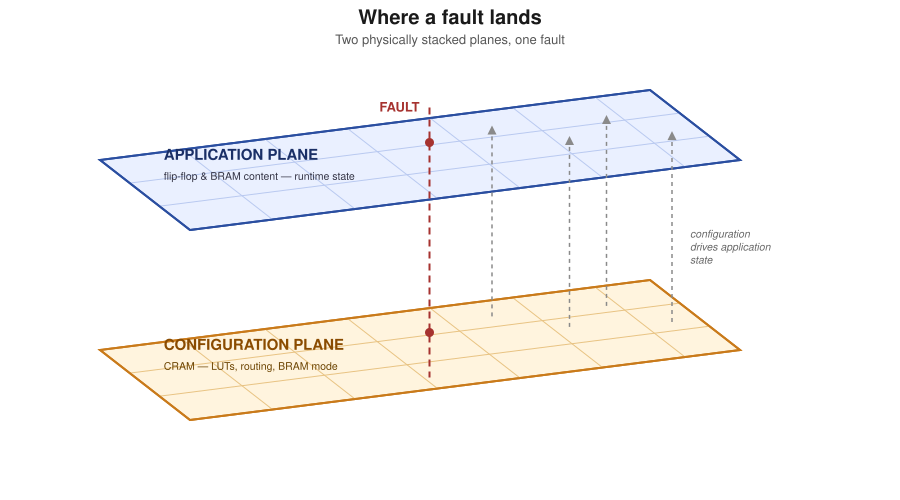

# SK-RAFT concepts

This document explains how SK-RAFT finds and describes a fault. The information applies to all examples. The getting-started examples (`examples/`) show the same concepts on hardware.

## The two planes

Each fault that SK-RAFT injects goes into one of two planes.

The **configuration plane** is the bitstream. It is the configuration RAM (CRAM) that sets the function of the FPGA fabric:

- The truth table of each LUT.
- The routing between the LUTs.
- The mode and width of each BRAM.
- The configuration of each primitive.

A fault in this plane changes the structure of the circuit.

The **application plane** is the application RAM (ARAM): the dynamic state of the configured circuit during operation. Examples are the current value of a flip-flop and the data in a BRAM or a LUTRAM. A fault in this plane changes a value. It does not change the circuit.

SK-RAFT can change the two planes directly:

- `TargetMemory.FF`, `TargetMemory.LUTRAM` and `TargetMemory.BRAM` inject into the application plane. They flip the current value of a register or a bit of a stored data word.
- `TargetMemory.CRAM` and `TargetMemory.ESSENTIAL_CRAM` inject into the configuration plane.

*The application plane (flip-flop and BRAM state) is on top of the configuration plane (CRAM), which sets the circuit. A fault can occur in each plane at the same physical location. The next two sections explain two special cases: essential bits in the configuration plane, and LUTRAM, which is in the two planes.*

## Essential bits

A design uses only a small part of the CRAM of a device. The other bits control routing or functions that the design does not use. A random bit flip in CRAM (`TargetMemory.CRAM`) usually goes into one of these unused bits. Then the flip has no effect that you can see.

**Essential bits** are the CRAM bits that one design uses. SK-RAFT reads them from the `.ebd` file of the design. With `TargetMemory.ESSENTIAL_CRAM`, each injected bit is a bit that the design uses. Thus each flip can cause an effect that you can see. Example 1 shows this difference step by step.

## LUTRAM

LUTRAM is the one case that is in the two planes. A LUT that operates as distributed RAM keeps its data in its own configuration bits (the INIT field). Thus a LUTRAM word is physically a set of essential configuration bits, but the circuit uses the word as application data. `TargetMemory.LUTRAM` selects these bits.

BRAM keeps the two planes separate. The configuration of a BRAM (mode and width) and its content are in different frame types. The configuration is in block type 0 frames and the content is in block type 1 frames (refer to `examples/example4`). Thus `TargetMemory.ESSENTIAL_CRAM` and `TargetMemory.BRAM` never select the same bits.

## Pblocks: limit the injection area

You can limit each of the targets above to one pblock of the XDC file of the design. Use the `pblock=` argument of `bit_count`, `inject_random` and `inject_exhaustive`. SK-RAFT then injects only into that area of the design, for example into one heartbeat counter, one adder or one BRAM. The plane and the set of essential bits do not change.

## Location of a bit: FAR, word index and bit index

SK-RAFT always uses three coordinates for the location of a bit, in reports and in arguments:

1. The frame address (FAR).
2. The word index in the frame.
3. The bit index in the word.

`dev.decode_far()` decodes a FAR into its block type, top or bottom half, row, column and minor frame number. Use this method to find if a fault is in the configuration (block type 0) or in the content (block type 1). `example4` shows this.

## `TargetMemory` summary

| `TargetMemory` | Plane | Selects | Example |
| --- | --- | --- | --- |
| `CRAM` | Configuration | All configuration bits, essential or not | example1 (step 1) |
| `ESSENTIAL_CRAM` | Configuration | Only the bits that the `.ebd` file of the design marks as essential | example1 (steps 2 and 3), example2, example4 (part 1) |
| `FF` | Application | The current value of a flip-flop | example3 (part 1) |
| `LUTRAM` | Configuration, used as application data | The essential configuration bits of a distributed-RAM word | example3 (part 2) |
| `BRAM` | Application | A word in block RAM (content frames, block type 1) | example4 (part 2) |
