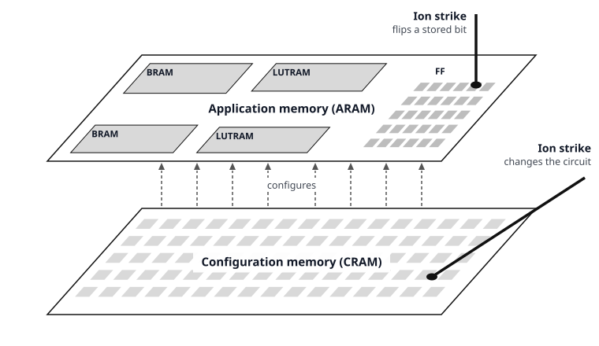

# SK-RAFT concepts

For the rules of the injection setup (safe-startup clock, clock stop during application memory injection, BRAM output latch), refer to [`injection_cheatsheet.md`](injection_cheatsheet.md).

## Conceptual model of an SRAM-based FPGA

The following figure presents a conceptual model of an SRAM-based FPGA to illustrate the radiation-induced failure modes of such devices. The model divides the chip into two layers: the configuration layer, which holds the FPGA's configuration memory (CRAM), and the application layer, which implements the circuit. A failure in the application layer can arise for two reasons. First, highly energetic particles, such as heavy ions, can strike and corrupt the CRAM bits that configure the resources the circuit uses, thereby altering the logic or routing of the implemented design. Second, particles can strike and corrupt application memory elements in the application layer (ARAM), such as flip-flops and the contents of block RAMs (BRAMs).

Each fault that SK-RAFT injects goes into one of the two layers:

- **CRAM layer:** Corrupts the FPGA's programmable resources, such as LUTs, global and local routing, and BRAM mode and width. A fault (i.e., a bit flip) in this layer changes the structure of the application circuit. The directives `TargetMemory.CRAM` and `TargetMemory.ESSENTIAL_CRAM` inject faults into the configuration layer.
- **ARAM layer:** Corrupts the dynamic state of the configured circuit during operation. Examples include the current value of a flip-flop and the data in a BRAM or a LUTRAM. A fault in this layer changes a value but not the circuit. Directives `TargetMemory.FF`, `TargetMemory.LUTRAM` and `TargetMemory.BRAM` inject into the application layer. 

## Targeted fault injection 

### Essential bits

Even the densest FPGA design uses only a small part of the CRAM. Thus, a bit flip (fault) in CRAM (`TargetMemory.CRAM`) usually goes into one of these unused CRAM bits. Then the flip has no effect that you can see.

**Essential bits** are CRAM bits that, when corrupted, can cause an application-observable error. SK-RAFT reads the bits from the `.ebd` file of the design that is generated from Vivado bitgen. Thus, targeting faults only in essential CRAM bits (`TargetMemory.ESSENTIAL_CRAM`) can significantly reduce testing time, since only those bits that matter are tested.

### Targeting or excluding resources from fault injection

You can inject faults only to the resources of a specific Pblock defined in your XDC constraints file. Combine `pblock=<pblock_name>` with `TargetMemory.FF`, `TargetMemory.LUTRAM`, `TargetMemory.BRAM`, `TargetMemory.CRAM` and `TargetMemory.ESSENTIAL_CRAM` to inject faults into the specific Pblock. To exclude configuration frames from testing, give their frame addresses (FARs) to `dev.exclude_frames()`. The exclusion has no effect on `dev.inject_at()`.

### Location of a bit: FAR, word index and bit index

SK-RAFT always uses three coordinates for the location of a bit, in reports and in arguments:

1. The frame address (FAR).
2. The word index in the frame.
3. The bit index in the word.

`dev.decode_far()` decodes a FAR into its block type, top or bottom half, row, column and minor frame number (see 7 Series FPGAs Configuration User Guide - UG470). 
