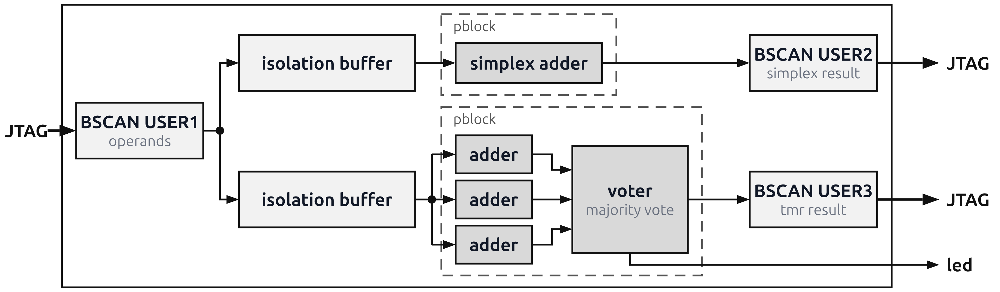

# Example 2: BSCAN-controlled adders, simplex against TMR, single-bit upsets

This example programs a bitstream. Then it compares a simplex adder with a triplicated (TMR) adder. Each adder is in its own pblock.

The two adders use one operand register (USER1). Each adder has its own result register: USER2 for the simplex adder and USER3 for the TMR adder.



Each trial does these steps:

1. It injects one random essential bit into each pblock.
2. It sends 100 random operand pairs through the two adders.
3. It marks an adder as failed if one or more of its results are wrong.
4. It flips the two bits again to correct the upsets.

The trials continue until you press Enter.

## Run the example

1. Make sure that the design files are in `src/design_files/`. Refer to [Build a design](../README.md#build-a-design) or [Prebuilt design files](../README.md#prebuilt-design-files).
2. At the top of `src/main.py`, set `SK_RAFT_SERVER_IP`, `DEVICE` and `design`.
3. Run the script:

```bash
cd src
python main.py
```

| Constant | Default | Description |
| --- | --- | --- |
| `design` | `bscan_adder_top.{bit,ebd}` + XDC | The design files. The script uploads them to the server. |
| `PBLOCK_SIMPLEX` / `PBLOCK_TMR` | `"pblock_sngl_add"` / `"pblock_tmr_add"` | The two pblocks for the test, as the XDC file names them. |
| `OP_LEN` | `4` | The operand width. It must be equal to the `op_len` generic of the design. |

## Result

First, the script prints the number of essential bits in each pblock. Then it updates one status line during the trials. The status line shows:

- The number of trials.
- The result of each adder for the last trial: green "Correct" or red "Wrong".
- The vulnerability factor (VF) of each adder: the fraction of trials in which the adder failed.

When you stop the script, it prints the final error counts and the VFs.

Each trial corrects its bits immediately after the check. Thus the configuration of the device is clean at the end. If you stop the script with Ctrl+C during a trial, a bit can stay flipped. In that case, program the FPGA again before you do other work.
