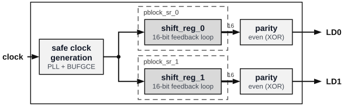

# Example 1: CRAM injection in three steps

This example shows the CRAM injection functions of SK-RAFT in three steps on one design. Each step is more selective than the step before it:

1. **Full-device CRAM.** The script reads back all the CRAM frames. Then it upsets random bits in these frames.
2. **Essential bits.** The server selects each bit from the design's essential bits. The server reads the essential bits from the EBD file.
3. **The essential bits of one pblock.** This step is the same as step 2, but in one pblock at a time: first `pblock_sr_0`, then `pblock_sr_1`.

The script keeps each upset for 100 ms, then flips the same bit again to correct it. Step 1 stops after 200 upsets, or earlier when you press Enter. Step 2, and each pblock in step 3, continue until you press Enter. The script reprograms the FPGA before steps 2 and 3. Monitor the LEDs on the board to see the effect of each upset.

## Design



The design for this example is [`targeted_top`](../hw/sources_1/new/targeted_top.vhd). It has two 16-bit shift registers with a feedback loop, `shift_reg_0` and `shift_reg_1`, each in its own pblock. Both shift at each clock cycle. The design computes the even parity of each register, outside the pblocks, and shows it on an LED: LD0 for `shift_reg_0`, LD1 for `shift_reg_1`.

Each register starts with one '1' bit, so both LEDs are on. A shift does not change the number of '1' bits, so the LEDs stay on. An upset that changes the number of '1' bits in a register changes its LED. The register keeps the changed bits after the script corrects the upset: the LED stays changed until the script programs the FPGA again, or until a second upset changes the register again.

The two registers are identical, so synthesis would keep only one of them. The `dont_touch` attribute on their instances keeps both.

The XDC file of the design declares the two pblocks, for example (Basys 3):

```tcl
create_pblock pblock_sr_0
add_cells_to_pblock [get_pblocks pblock_sr_0] [get_cells -quiet [list shift_reg_0]]
resize_pblock [get_pblocks pblock_sr_0] -add {SLICE_X54Y91:SLICE_X57Y99}
```

A pblock keeps the cells of its instance in the given area. Two more properties control the pblock:

- `set_property EXCLUDE_PLACEMENT true [get_pblocks ...]` prevents the placement of other cells in the pblock.
- `set_property CONTAIN_ROUTING true [get_pblocks ...]` keeps the routing of the pblock inside the pblock.

The examples do not use `CONTAIN_ROUTING`, to keep them simple.

## The calls of the example

| Call | Use in the example |
| --- | --- |
| `SkraftFpga.connect(ip=..., port=...)`, `client.get_devices()`, `client.attach(serial_number)` | Connect to the SK-RAFT server, select the first board that the server lists and attach to it, in `with` statements that release the device and close the connection. |
| `Design(bit, ebd, xdc)`, `dev.upload_design_to_server(design)`, `dev.program_fpga(design)` | Give the design files, upload them to the server and program the FPGA. |
| `dev.configure_seed(0)` | Set the seed of the random injections. The same seed gives the same upsets in each run. |
| `dev.readback(ReadbackOption.READBACK)` | Step 1: read back all the CRAM frames. The script selects a random bit of these frames. |
| `dev.inject_at(far, word, bit, TargetMemory.CRAM)` | Step 1: flip the selected bit. In all steps: flip the bit again after 100 ms, to correct the upset. |
| `dev.bit_count(TargetMemory.ESSENTIAL_CRAM)`, `dev.bit_count(TargetMemory.ESSENTIAL_CRAM, pblock=pblock)` | Steps 2 and 3: get the number of essential bits of the device, and of each pblock. |
| `dev.inject_random(TargetMemory.ESSENTIAL_CRAM)` | Step 2: inject one upset into a random essential bit. |
| `dev.inject_random(TargetMemory.ESSENTIAL_CRAM, pblock=pblock)` | Step 3: inject one upset into a random essential bit of one pblock. |

## Run the example

1. Make sure that the design files are in `hw/design_examples/<board>/targeted_top/`, and set `BOARD` in `src/main.py` to your board. Refer to [Build a design](../README.md#build-a-design) or [Prebuilt design files](../README.md#prebuilt-design-files).
2. At the top of `src/main.py`, set `SK_RAFT_SERVER_IP`. The script attaches to the first board that the server lists. Connect only the target board to the server.
3. Run the script:

```bash
cd src
python main.py
```

| Constant | Default | Description |
| --- | --- | --- |
| `design` | `targeted_top.{bit,ebd}` + XDC | The design files. The script uploads them to the server. |
| `STEP1_UPSETS` | `200` | The number of upsets in step 1. Press Enter to stop step 1 earlier. |
| `PBLOCKS` | `pblock_sr_0`, `pblock_sr_1` | The pblocks for step 3, as the XDC file names them. |

## Result

Sample output of a run on a Basys 3 (shortened). The frame addresses, the bit counts and the error counts depend on the board, the build and the seed.

```
SK-RAFT client 1.0.0, server 1.0.3
programmed 210183BA2524A with ../../hw/design_examples/basys3/targeted_top/targeted_top.bit

Step 1: random bits, anywhere. 200 upsets, or press Enter to move on.
frames read back: 5568
  1: far 0x00c000cb word  14 bit  1
  2: far 0x00020a14 word  31 bit 14
...

Step 2: essential bits only (7906) . Press Enter to move on.
  1: far 0x00001400 word  50 bit 31
  2: far 0x00001094 word  83 bit 20
...

Step 3: one pblock at a time.

pblock_sr_0: essential bits (1129). Press Enter to move on.
  1: far 0x000011a0 word  83 bit 30
  2: far 0x0000118f word  84 bit 15
...

pblock_sr_1: essential bits (1076). Press Enter to move on.
  1: far 0x0000141e word  13 bit  3
  2: far 0x00001408 word  12 bit  6
...

Example 1 done.
```

The script corrects each upset. Thus, the device configuration is clean at the end. The shift registers can still hold bits that an upset changed: program the FPGA again to start them from one '1' bit. If you stop the script with Ctrl+C during an upset, the upset can remain in the device. In that case, reprogram the FPGA before you do any other work.
